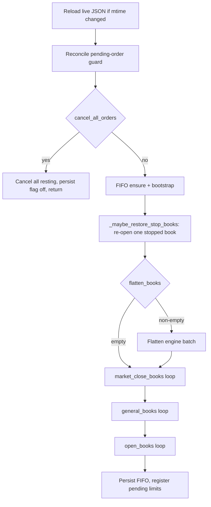

# TopAgent

Reference and working notes for [`TopAgent.py`](TopAgent.py): what it does each tick, how the
config drives it, and how that maps onto the validator's scoring.

Code is the source of truth. Where this doc records a *decision* rather than current behavior it is
marked **[decision]**; where current behavior looks unintended it is marked **[hazard]**.

---

## 1. Role in the fleet

TopAgent is the per-book trading miner. It posts resting limits driven entirely by JSON book lists
and hot-reloads that JSON while running (`live_config=1`).

[`HelpAgent.py`](HelpAgent.py) is the counterpart: it runs no open logic of its own, it reads the
*target's* `topagent.<uid>.json` and IOC-fills that target's `open_books` levels, using the target's
`waiting_orders.json` for prices (falling back to the same mid ± bracket/2 math on the same tick).

A typical pairing in this repo: TopAgent on UID 120 posts the bracket, HelpAgent on 135 and 230
fill it.

---

## 2. Why the engines exist: the scoring model

The validator's de-beta score ([`taos/im/validator/debeta.py`](../taos/im/validator/debeta.py)) is

```
score = w_make · making_rank + (1 − w_make) · skill_rank
```

with `w_make` defaulting to **0.30**, so the score is skill-led. Both legs are *ranks*, not
magnitudes.

### 2.1 Skill leg — kappa of alpha

Per book, `alpha = MTM_path_integral − mean_inventory × book_drift`, where the MTM path integral is
`Σ inv·dp` over the book's print stream. Inventory is revalued on each print *before* that print's
own fill is applied, so the exit print of a bracket revalues the position you are still holding:
a round trip of `qty` across a bracket of width `w` books `alpha ≈ qty · w`.

`kappa_of_alpha` then measures **consistency across books**, and it has three properties that
dictate strategy:

| Property | Consequence |
|---|---|
| **Scale-invariant** | `[1,1,1,1]` and `[100,100,100,100]` both give exactly **10.0**. Bigger alpha does not raise kappa. |
| **Hard cap at 10** | From the regularizer `(|mean|+sd)³·1e-3`; zero dispersion ⇒ `mean/(0.1·mean)` = 10. |
| **Needs ≥ 4 books** | Fixed inside `kappa_of_alpha`, not configurable. |

Dispersion and sign are what actually move it:

| Book alphas | kappa |
|---|---|
| `[100]×4` (or `[1]×4`) | 10.00 |
| 4 books at ±5% | 9.62 |
| 4 books at ±20% | 8.64 |
| `[100]×3 + [−100]` | **0.79** |
| `[100]×11 + [−100]` | 1.89 |

A single negative qualifying book is far more damaging than any amount of spread between positive
ones, because the downside term is cubed.

### 2.2 The floor is the only place magnitude matters

`kappa_floored` only counts a book when `|alpha| ≥ floor`, where

```
floor = floor_scale × median(|alpha|)      # over every per-book alpha of every miner
```

`floor_scale` defaults to **0.5**. So size exists to clear the floor, and nothing beyond that.

**You cannot pick which books count.** Every book whose `|alpha|` clears the floor enters kappa
automatically. A TopAgent quoting 128 general books therefore contributes ~128 scattered alphas and
collapses its own kappa no matter how clean its bracket books are. **[decision]** A UID running for
skill score trades only its chosen book set; `general_books` stays empty there.

### 2.3 Making leg and P11

Making is `Σ_books 2·min(buy_capture, sell_capture)` against a centered mid (half-window 15 trades),
clamped at 0 — genuinely two-sided capture per book, one-sided accumulation scores nothing.

It is then discounted by counterparty concentration: `making × (1 − p11_strength · EC⁺)`, with
`p11_strength` defaulting to **1.0** and `EC` measured over the **top 2 miner takers**.

The important detail: non-miner takers (background agents, external flow) are bucketed as
`MARKET_FLOW` and are **excluded from the top-k**, while shares are computed over total flow. So
fills from the simulation's own agents do not concentrate you at all, while fills from two dedicated
helper UIDs drive `EC → 1` and zero the entire making leg.

### 2.4 Alpha is zero-sum

`Σ inv = 0` across all participants, so `Σ inv·dp = 0`. Whatever alpha the bracket books, the
counterparty books the exact negative. When your own HelpAgent fills the bracket, that loss lands on
your own UID: the helper gets negative kappa (skill_rank 0) and negative capture (making 0).

Practical consequence: helper fills cost you twice — the mirrored alpha loss *and* the P11 discount.
**[decision]** Helpers are a fallback for stale legs, not the primary fill source; their share of a
book's volume should stay low.

### 2.5 Windows and dials to watch

| Dial | Default | Why it matters |
|---|---|---|
| `scoring.kappa.lookback` | 3h sim | Both de-beta legs are pruned on this window; alphas must stay equal *within* it, so cadence beats bursts. |
| `scoring.debeta.w_make` | 0.30 | Skill-led split. |
| `scoring.debeta.floor_scale` | 0.5 | Qualifying threshold. |
| `scoring.debeta.p11_strength` | 1.0 | Full removal of a feeder-fed maker's making. |
| `scoring.debeta.mark_mode` | `last` | **Load-bearing.** At `median`/`vwap` (window 200) a single print can no longer revalue inventory, and bracket-manufactured alpha stops working. |
| `scoring.debeta.presence_gate` | 1 | 50 consecutive failed queries ⇒ not scorable. |

---

## 3. Tick pipeline

`respond_simulation` (verified against current code):



Precedence on a single book:

1. `flatten_books` wins over everything.
2. `market_close_books` and `stop_books` block the open engine.
3. A book in both `open_books` and `general_books` is handled by **open** only.
4. `market_close` skips books that are in `general_books`.

**[resolved] The close engine has been removed.** It was defined but never called from
`respond_simulation`, so `close_books`, `close_engine`, and `close_target_price` were inert. Exit
happens only via the open bracket's opposite leg, flatten, or market close. The module docstring
another. The dead definitions, both config keys, and the `close_books` list are now gone;
`close_quantity` and `close_dust_threshold` survive because market close still sizes from them.

---

## 4. Open engine

The core engine: a same-tick two-sided GTT bracket per book.

### 4.1 Price selection and locking

| Mode | Prices |
|---|---|
| Mid (`use_depth_qty=false`, prices 0) | BUY @ `mid − bracket/2`, SELL @ `mid + bracket/2` from L2 touch mid |
| Depth (`use_depth_qty=true`) | Lock P from the L21 depth snapshot, bracket around it |
| Manual | Set `open_price` and `close_price` in JSON; they are used as-is |

`bracket` is the per-book `bracket_ticks` if present, else the global `bracket_ticks`. On the first
tick the resolved pair is **written back into the live JSON** (`open_price` = buy leg,
`close_price` = sell leg) and reused thereafter. Reset either to `0` in JSON to re-snapshot.

Because both legs must rest passively, the book's touch spread has to be at least the bracket
width — `bracket_ticks: 100` at `priceDecimals=2` means a 1.00 wide bracket and needs a spread ≥ 1.00.
**[decision]** Book selection filters on spread, and the bracket is sized to the spread rather than
fixed.

### 4.2 Sizing

```2066:2084:agents/TopAgent.py
    def _open_bracket_order_qty(
        self,
        acct,
        direction: OrderDirection,
        price: float,
        room: float,
        clip: float,
        vd: int,
        min_sz: float,
    ) -> float:
        if room < min_sz - 1e-12 or price <= 0.0:
            return 0.0
        if direction == OrderDirection.BUY:
            quote_free = float(acct.quote_balance.free)
            available_qty = quote_free / price if quote_free > 0.0 else 0.0
        else:
            base_free = float(acct.base_balance.free)
            available_qty = base_free if base_free > 0.0 else 0.0
        return round(min(clip, room, max(0.0, available_qty - 1.0)), vd)
```

- `clip = min(open_quantity, spec.max_quantity)`
- `room = max_quantity − cumulative fills on that side`
- `available − 1.0` is a **1 BASE reserve** applied to both sides

The reserve is why the two legs are often asymmetric when a book is balance-tight: the BUY side
converts quote at the quoted price while the SELL side uses free base directly, so a short base
position shrinks only the sell leg. Observed on book 23: `BUY 100.0@322.37` against
`SELL 12.8381@322.87`.

### 4.3 Refresh, fill caps, retire

`_refresh_open_bracket_side` keeps exactly one GTT rest per side at the target price. If the resting
order is within half a tick of target it is left alone; if it is stale it is **cancelled and the
tick ends there** — the replacement goes out on a later tick once the book shows no rest on that
side. So a price move costs at least one tick of absence per side, and the pending guard blocks a
re-send while a prior send is still unconfirmed.

Per-side cumulative fills are tracked in `_open_book_side_fills`. When **both** sides reach
`max_quantity` (tolerance = `min_order_size`), `_retire_open_book` moves the book out of
`open_books` and into `stop_books` and logs the leftover inventory dust. No flatten is performed, so
a retired book can leave a residual position behind — this is how book 23 ended at roughly −1 BASE.

**[resolved] `_maybe_restore_stop_books` now re-opens stopped books automatically.** A stopped book
whose `|alpha|` is under the field baseline earns no skill score, so it is dead weight. Each tick the
agent re-opens at most one such book, gated on:

| Gate | Source | Default |
|---|---|---|
| `\|alpha\| < baseline` | `debeta_baseline.<uid>.json` from BookManageBot | — |
| touch spread `>=` | `restore_min_spread` | `0.5` |
| resting size at both touches `<` | `restore_max_touch_qty` | `20` |
| per-book cooldown | `restore_cooldown_minutes` (sim time) | `30` |

The re-opened entry uses `restore_bracket_ticks` (50) and `restore_quantity` (100), with
`open_price=0` so the bracket re-locks on the next tick. Books in `flatten_books` or
`market_close_books` are never restored, and a missing or stale baseline file (older than
`alpha_baseline_max_age_sec`, default 900s) means the whole rule no-ops.

**The fill-cap epoch is what makes a restore survive.** `_seed_open_book_side_fills` replays the
whole session `trades.csv` so a process restart does not forget the caps — which means a restored
book would instantly re-count its entire previous life and retire on the same tick. This is not
hypothetical; the first production restore of book 23 was retired 16 ms later on `buy_filled=300,
sell_filled=300` against `max=100`. So a restore now records `_open_fills_epoch[book]` = the highest
`tradeId` seen on that book, and `_apply_open_book_fill` ignores anything at or below it. The epoch
is persisted as `open_fills_epoch` in the live JSON, so a restart after a restore still honours it.

When a book is skipped the agent logs the failing gate once per gate (not per tick) as
`TopAgent restore book <id> blocked [spread|touch_qty|scored|no_book|no_quote]`, with the live
numbers. This matters because the common case is a rule that silently never fires.

The agent cannot compute the baseline itself: a miner only sees its own fills, while the validator's
floor is a field-wide statistic over every miner's books. BookManageBot already scrapes both the
per-book `debeta_alpha` gauges and the field mean, so an `AlphaBaselineWriter` thread there publishes
`{baseline, alphas}` to `agents/data/debeta_baseline.<uid>.json` every `interval_sec` (default 120).
Enable per uid under `alpha_baseline:` in `miners.yaml`; inspect with
`GET /api/alpha-baseline/status` and force a refresh with `POST /api/alpha-baseline/poll`.

BMB's baseline is `0.5 * median(|alpha|)` over the field, matching the validator's
`floor_scale * median(|alpha|)`. Where a miner row carries the validator's own
`debeta_skill_floor` gauge, BMB counts scored books against that instead, so the count
agrees with the dashboard exactly; the field median is the fallback.

### 4.4 `open_books[]` entry fields

| Field | Meaning |
|---|---|
| `book` | Book id |
| `open_price` | Buy leg (post leg when `open_direction=SELL`); `0` = lock on first tick |
| `close_price` | Sell leg (close leg); `0` = locked together with `open_price` |
| `max_quantity` | Per-side cumulative fill cap before retire |
| `bracket_ticks` | Per-book override of the global bracket width |
| `use_depth_qty` | Depth snapshot mode instead of mid ± bracket/2 |
| `depth_qty` / `open_depth_qty` | Depth volume used for the snapshot |
| `open_direction` | `BUY` (default) posts BUY at `open_price`; `SELL` inverts the legs |

---

## 5. General engine

Two-sided maker across many books, sized for the **making** leg rather than skill.

- Quotes `mid ∓ general_ticks`, then clamps to stay passive (`buy ≤ best_ask − tick`,
  `sell ≥ best_bid + tick`).
- Clip is `min(general_quantity, spec.max_quantity, 0.5)`.
- Inventory-aware: `buy_room = clip − fifo_net`, `sell_room = clip + fifo_net`, and the adding side
  is suppressed entirely once `|fifo_net| > general_open_max` (default 0.25). This keeps per-book
  alpha small — which is exactly what you want on a general book, since sub-floor alphas stay out of
  kappa.
- Skipped on books that are in `open_books` or `flatten_books`.

**[resolved]** `_maybe_general_make` used to be defined twice (the second won), `parse_stop_books`
three times, and several `initialize` assignments were duplicated. All shadowed copies have been
removed, keeping the definition that was actually winning at runtime in each case. The only pair
that differed was `_cancel_all_resting_on_book`, where the winning version batches cancels and
returns a count; that is the one that survived.

---

## 6. Flatten and market close

**Flatten** (`flatten_books[]`) runs as a batch through
`strategy_engine.process_topagent_flatten`: cancel all resting orders on the book, then market-close
the validator net (`free_base − int_base`) using `flatten_max_slippage`. It blocks every other engine
on that book and auto-retires the book when flat.

**Market close** (`market_close_books[]`) sends one market order of `close_quantity` per tick in the
direction that reduces the position, using `market_close_max_slippage`. Skipped on books that are in
`general_books`.

---

## 7. Config reference

Hot-reloadable scalars live in `LIVE_SCALAR_KEYS` / `LIVE_BOOL_SCALAR_KEYS`. The ones that matter in
practice:

| Key | Effect |
|---|---|
| `open_quantity` | Per-send clip for both open legs |
| `bracket_ticks` | Global bracket width; per-book value overrides |
| `open_dust_stop_threshold` | Dust tolerance reported at retire |
| `general_ticks`, `general_quantity`, `general_open_max` | General maker offset, clip, inventory gate |
| `expiry_period` | GTT lifetime (ns) |
| `max_pending_per_book` | Matches the validator's per-book instruction cap (default 5) |
| `recharge_times` | Published into `waiting_orders.json`; HelpAgent reads it from the target config |
| `restore_bracket_ticks`, `restore_quantity` | Bracket width and per-side cap for a restored book |
| `restore_min_spread`, `restore_max_touch_qty` | Touch gates for the stop → open restore |
| `restore_cooldown_minutes` | Sim-time wait before a book can be restored again |
| `alpha_baseline_max_age_sec` | Staleness cutoff on the BookManageBot baseline file |
| `use_depth_qty`, `cancel_all_orders`, `fifo_log_trades`, `restore_stop_books` | Boolean live keys |
| `force_adopt_book_lists` | Replace in-memory book lists from JSON on reload |

`alpha_baseline_path` is read once at `initialize` and defaults to
`agents/data/debeta_baseline.<uid>.json`; it is not hot-reloadable.

Book lists (`open_books`, `stop_books`, `general_books`, `flatten_books`, `market_close_books`)
are re-parsed on every reload. Note that `open_books` entries are filtered against
`stop_books` at load, so **a book listed in both is silently dropped from open**.

---

## 8. Operating playbook for a skill run

Derived from §2. Target: ≥ 4 books with equal, positive, above-floor alpha inside a 3h sim window.

1. **Pick 6–8 books, not 4.** Same kappa when clean (10.0 either way), materially more forgiving
   when one book misbehaves (one bad book among 4 → 0.79; among 8 → 1.49).
2. **Require touch spread ≥ intended bracket**, and size `bracket_ticks` to the observed spread so
   both legs rest passively.
3. **Keep the UID's book set clean.** `general_books: []` on any UID running for skill.
4. **Synchronize round trips across books** rather than maximizing any one. Alpha accumulates
   additively, so equal cycle counts give equal alphas, which is the entire kappa objective.
5. **Size to clear the floor, then stop.** Extra magnitude adds nothing.
6. **Never let a chosen book end a window negative.** This single rule dominates everything else.
7. **Cap helper share per book** so `EC` stays low and the making leg survives; prefer fills from
   background flow, which is exempt from the concentration measure.
8. **Keep answering the validator** — the presence gate drops a UID after 50 consecutive failures.

---

## 9. Observability

- Startup line: `TopAgent uid=… open=… close=… general=… market_close=… flatten=… stop=… live=…`
- Reload line: `TopAgent live reload (mtime): bracket_ticks=2->50, open_books=[23] …`
- Price lock: `TopAgent book 23: locked open_price=322.37 close_price=322.87 into topagent.120.json`
- Retire: `TopAgent open book 23 retired: buy_filled=… sell_filled=… max=… dust=… stop=True`
- `agents/data/<uid>/waiting_orders.json` — confirmed + waiting orders (plus `recharge_times` /
  `recharge_used` on HelpAgent UIDs)
- FIFO snapshots under the agent's `data_dir`

---

## 10. Fleet

| UID | PM2 | Agent | Config |
|---|---|---|---|
| 120 | `miner-sn79-gold-9099-sn1005` (9099) | TopAgent | `data/topagent.120.json` |
| 135 | `miner-sn79-gold-9101-sn1004` (9101) | HelpAgent → 120, shard 0/2 | `data/helpagent.135.json` |
| 230 | `miner-sn79-gold-9102-sn1003` (9102) | HelpAgent → 120, shard 1/2 | `data/helpagent.230.json` |

Deploy scripts: `mainnet/run_topagent135.sh`, `mainnet/run_topagent230.sh`,
`mainnet/run_help135.sh`, `mainnet/run_help230.sh`.

---

## 11. Open questions

- [ ] Retire leaves residual inventory. Should retire optionally flatten, or hand the book to
      `flatten_books` automatically when `dust > open_dust_stop_threshold`?
- [ ] Should the restore rule also cap total re-opens per book (the way `recharge_times` caps
      HelpAgent), or is the cooldown enough?
- [x] BMB published `mean(|alpha|)/2` as the baseline while the validator uses
      `floor_scale * median(|alpha|)`. Switched to the median, and to the validator's
      `debeta_skill_floor` gauge where the row carries it.
- [ ] An alpha-budget controller that reads per-book alpha from BMB and throttles round trips to keep
      the chosen books equal — worth building into the open engine, or a separate supervisor?
- [ ] Contingency if `mark_mode` moves off `last`.

---

## 12. Changelog

| Date | Change |
|---|---|
| 2026-09-19 | Initial version: tick pipeline, engines, scoring model, playbook, hazards |
| 2026-09-19 | Removed the dead close engine; deduplicated shadowed definitions |
| 2026-09-19 | Implemented the stop → open restore off the new BookManageBot alpha/baseline feed |
| 2026-09-19 | Added the `open_fills_epoch` watermark so a restored book does not retire on its old fills |
| 2026-09-20 | BMB baseline switched from `mean(|alpha|)/2` to `0.5*median(|alpha|)`; scored-book count now prefers the validator's `debeta_skill_floor` gauge |
